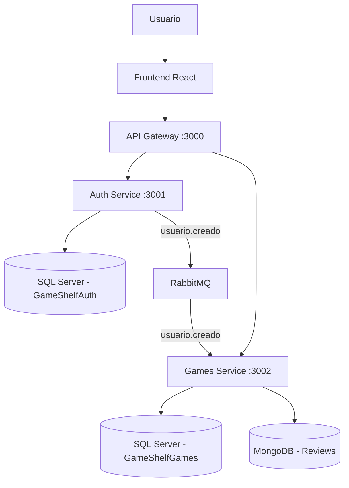

# GameShelf

Proyecto final Fullstack: aplicación para gestionar una colección personal de videojuegos, con autenticación JWT, reseñas y arquitectura de microservicios.

## Tecnologías

- Frontend: React, Vite, Axios, TanStack Query
- Backend: Node.js, Express
- Bases de datos: Microsoft SQL Server y MongoDB
- Autenticación: JWT y bcrypt
- Mensajería: RabbitMQ
- Infraestructura: Docker y Docker Compose
- Testing: Jest, Supertest, Vitest y React Testing Library

## Arquitectura



El frontend utiliza exclusivamente el API Gateway para comunicarse con los microservicios.

### Auth Service

Responsable del registro de usuarios, inicio de sesión y generación de tokens JWT. Utiliza su propia base de datos SQL Server.

### Games Service

Gestiona los videojuegos del usuario en SQL Server y las reseñas en MongoDB. Valida JWT y utiliza separación de responsabilidades con un servicio de aplicación y un repositorio inyectado.

### API Gateway

Punto de entrada HTTP que redirige las solicitudes hacia Auth y Games.

### RabbitMQ

Auth publica el evento `usuario.creado` en el exchange `gameshelf.events`, con routing key `usuario.creado`.

Games consume el evento de forma asíncrona mediante la cola `gameshelf.user.created`.

## Endpoints

Base URL: `http://localhost:3000/api`

| Método | Endpoint | Autenticación | Descripción |
|---|---|---|---|
| POST | /auth/register | No | Registrar usuario |
| POST | /auth/login | No | Iniciar sesión |
| GET | /games | JWT | Listar videojuegos |
| GET | /games/:id | JWT | Consultar videojuego |
| POST | /games | JWT | Crear videojuego |
| PUT | /games/:id | JWT | Actualizar videojuego |
| DELETE | /games/:id | JWT | Eliminar videojuego |
| GET | /reviews/:gameId | JWT | Listar reseñas |
| POST | /reviews/:gameId | JWT | Crear reseña |
| GET | /health | No | Estado del Gateway |

Las rutas protegidas requieren:

`Authorization: Bearer <token>`

## Ejecución con Docker

### Requisitos

- Docker Desktop con Docker Compose
- Node.js y npm para ejecutar el frontend y las pruebas

### Configuración

1. Clonar el repositorio.
2. Copiar `.env.example` a `.env`.
3. Configurar las variables de entorno necesarias para SQL Server, JWT y RabbitMQ.

No subir archivos `.env` ni credenciales al repositorio.

### Levantar los servicios

Desde la raíz:

```bash
docker compose up -d --build
```

Docker Compose levanta SQL Server, MongoDB, RabbitMQ, Auth, Games y API Gateway, además de ejecutar la inicialización de las bases SQL.

### Ejecutar el frontend

```bash
cd frontend
npm install
npm run dev
```

Abrir la URL local indicada por Vite.

### Detener los servicios

```bash
docker compose down
```

## Pruebas automatizadas

Instalar las dependencias de los proyectos antes de ejecutar las pruebas:

```bash
npm install --prefix services/auth
npm install --prefix services/games
npm install --prefix gateway
npm install --prefix frontend
```

Con los servicios Docker activos, ejecutar desde la raíz:

```bash
npm test
```

La suite incluye:

- Validación de solicitudes de autenticación
- Protección de endpoints mediante JWT
- Pruebas unitarias de Games
- Integración de API Gateway
- Publicación y consumo de eventos RabbitMQ
- Renderizado de componentes React

Resultado de la última ejecución verificada: **15 pruebas aprobadas**.

Las pruebas de integración del Gateway y RabbitMQ requieren los contenedores funcionando.

## Organización

```text
gameshelf/
├── backend/              # Backend original de la primera etapa
├── frontend/             # Aplicación React
├── gateway/              # API Gateway
├── services/
│   ├── auth/             # Autenticación y usuarios
│   └── games/            # Videojuegos y reseñas
├── docker-compose.yml
├── .env.example
├── package.json
└── README.md
```

## Arquitectura de software

El proyecto combina microservicios con separación de responsabilidades y principios de arquitectura hexagonal en el módulo de videojuegos.

La lógica de negocio se organiza en servicios independientes del repositorio SQL, facilitando pruebas unitarias mediante dependencias simuladas.

## Estado del proyecto

- Microservicios Auth y Games implementados
- API Gateway funcionando
- SQL Server y MongoDB integrados
- Autenticación JWT
- Comunicación asíncrona con RabbitMQ
- Docker Compose
- Pruebas automatizadas
- Frontend React integrado con Gateway
